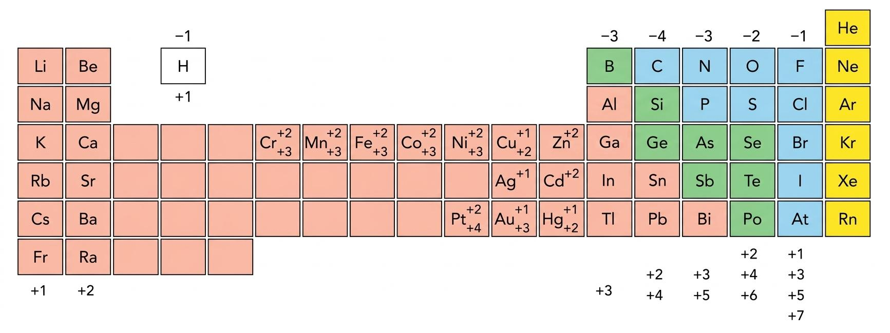

# Tema 3. Formulación y nomenclatura inorgánica

## **1. Nomenclatura química**

En 2005, la IUPAC acordó unas normas para unificar la nomenclatura, en las que el **número de oxidación** es un concepto clave. Gracias a él, podemos conocer la estequiometría de un compuesto, es decir, el número de átomos de cada elemento que lo forman.

Se denomina **número de oxidación** a la carga formal que adquiriría un átomo si todos sus enlaces fueran 100 % iónicos. Por tanto, este número será positivo si pierden electrones y negativo si los ganan.

### **Valencia y número de oxidación** {: .caja-subtitulo #no-toc }
Valencia y número de oxidación son términos relacionados. Por ejemplo, si un elemento posee dos números de oxidación, decimos que posee dos valencias o que será divalente.

### **Tabla de números de oxidación** {: .caja-subtitulo #no-toc }

Los números de oxidación que aparecen encabezando o finalizando una familia se aplican a todos sus elementos.

{ style="display: block; margin: 0 auto; width: 100%; height: auto;" }

Algunos elementos poseen más números de oxidación, como el nitrógeno: -1, +1, +2, +3, +4, +5.

## **2. Iones**

### **2.1 Cationes** {: .caja-subtitulo}

Son los átomos que han perdido electrones y quedan con carga positiva. Esta carga coincide con su número de oxidación. Si hay más de un número de oxidación o valencia, dará lugar a cationes del mismo elemento con diferente carga.

**Fórmula:** $\ce{M^{n+}}$

**Nombre:** M (carga y signo)

| Ion | Nomenclatura | Ion | Nomenclatura | Ion | Nomenclatura | 
| ----- | ----- | ----- | ----- | ----- | ----- | 
| $\ce{Na+}$ | sodio(1+) | $\ce{Ca^{2+}}$ | calcio(2+) | $\ce{Ag+}$ | plata(1+) | 
| $\ce{Al^{3+}}$ | aluminio(3+) | $\ce{Ni^{2+}}$ | níquel(2+) | $\ce{Ni^{3+}}$ | níquel(3+) | 
| $\ce{Fe^{3+}}$ | hierro(3+) | $\ce{Fe^{2+}}$ | hierro(2+) | $\ce{Sn^{4+}}$ | estaño(4+) | 

### **2.2 Aniones** {: .caja-subtitulo}

Son átomos que han ganado electrones y quedan con carga negativa. Esta carga coincide con el número de oxidación.

**Fórmula:** $\ce{X^{n-}}$

**Nombre:** X-uro (carga y signo)

El paréntesis sigue al nombre sin ningún espacio. En el caso de que el número de oxidación sea único (monovalente), se puede omitir su valor.

| Ion | Nomenclatura | Ion | Nomenclatura | 
| ----- | ----- | ----- | ----- | 
| $\ce{Cl-}$ | cloruro(1-) o cloruro | $\ce{S^{2-}}$ | sulfuro(2-) o sulfuro | 
| $\ce{F-}$ | fluoruro |  | **Excepción:** | 
| $\ce{H-}$ | hidruro | $\ce{O^{2-}}$ | óxido | 
| $\ce{N^{3-}}$ | nitruro | $\ce{O2^{2-}}$ | peróxido o dióxido(2-)\*| 

\*Corresponde a lo que se denomina anión homopoliatómico.

<!--- 
### **2.3 Aniones poliatómicos** {: .caja-subtitulo}

Los aniones pueden estar formados por más de un elemento. En este caso, su nomenclatura se puede realizar de dos maneras:

#### **A. Nomenclatura tradicional** {: .caja-subtitulo2 #no-toc }

Se utilizan prefijos y sufijos conforme al número de oxidación con que actúa el elemento que da lugar al anión. Se pueden presentar varios casos, según sea el número de valencias que posea dicho elemento:

| 1 valencia | 2 valencias | 3 valencias | 4 valencias | 
| ----- | ----- | ----- | ----- | 
| \-ato | \-ito | hipo- -ito | hipo- -ito | 
|  | \-ato | \-ito | \-ito | 
|  |  | \-ato | \-ato | 
|  |  |  | per- -ato | 

Para formularlos, se escribe el no metal con su número de oxidación indicado por el prefijo y sufijo y, a continuación, se añaden tantos oxígenos como sean necesarios, considerando que cada oxígeno añadido aporta dos cargas negativas, para que el ion quede con la mínima carga negativa posible.

*Por ejemplo, el cloro tiene cuatro valencias, así que tendríamos las posibilidades:*

* **hipoclorito:** +1

* **clorito:** +3

  $\ce{Cl^{3+} + O^{2-} = ClO+}$ *(Incorrecto)*

  $\ce{Cl^{3+} + (O2)^{4-} = ClO2-}$ *(Correcto)*

* **clorato:** +5

  $\ce{Cl^{5+} + O^{2-} = ClO^{3+}}$ *(Incorrecto)*

  $\ce{Cl^{5+} + (O2)^{4-} = ClO2+}$ *(Incorrecto)*

  $\ce{Cl^{5+} + (O3)^{6-} = ClO3-}$ *(Correcto)*

* **perclorato:** +7

### **B. Nomenclatura de hidrógeno (adición)** {: .caja-subtitulo2 #no-toc }

Indicamos primero el número de oxígenos con prefijos numéricos seguido de la palabra **oxido**. A continuación, el elemento de la izquierda acabado en el sufijo **-ato**. Por último, indicamos la carga entre paréntesis al final y sin separación.

Si hay hidrógenos, esta palabra se antepone al resto, que se pone entre paréntesis:

$$
\text{[Palabra hidrogeno-]} + \text{[Prefijo numeral (oxido)]} + \text{[Nombre del elemento-ato]} + \text{(carga ion)}
$$

**Ejemplo:**

$$
\ce{HCO3-} \quad \rightarrow \quad \text{hidrogeno(trioxidocarbonato)(1-)}
$$

| Ion | Nomenclatura | Ion | Nomenclatura | 
| ----- | ----- | ----- | ----- | 
| $\ce{SO3^{2-}}$ | trioxidosulfato(2-) | $\ce{H2PO4-}$ | dihidrogeno(tetraoxidofosfato)(1-) | 
| $\ce{SO4^{2-}}$ | tetraoxidosulfato(2-) | $\ce{ClO3-}$ | trioxidoclorato(1-) | 
| $\ce{Cr2O7^{2-}}$ | heptaoxidodicromato(2-) | $\ce{MnO2-}$ | dioxidomanganato(1-) | 

**Importante**

- No hay que dejar espacio entre el nombre y el paréntesis.
- En palabras compuestas como los aniones poliatómicos y las sales y ácidos que de ellos se deriven, pierden la tilde todos los elementos tónicos menos el último. Así pues, en estos casos no deberás acentuar las partículas *oxido-* ni *hidrogeno-*.

-->

## **3. Compuestos binarios**

Los compuestos binarios se forman por la unión de dos elementos, que se escriben de la siguiente forma:

$$
\ce{M_x X_y}
$$

* $\ce{M}$: El elemento menos electronegativo se escribe a la izquierda.

* $\ce{X}$: El elemento más electronegativo se sitúa a la derecha (con valencia negativa).

En la formación de un compuesto, asignamos a cada elemento una carga formal correspondiente al número de oxidación que utilice. Luego estos elementos se combinan en número de manera que la carga total sea nula.

Una regla sencilla que, aunque con excepciones, puede ayudar a la formulación del compuesto, es el intercambio de valencias y la posterior simplificación.

**Ejemplo de formulación:**
Sulfuro de plomo(IV): formado por $\ce{Pb^{4+}}$ y $\ce{S^{2-}}$

Intercambio cruzado:* $\ce{\quad Pb_2S_4 \rightarrow (simplificaci\textrm{ó}n) PbS2}$*

En este curso utilizaremos dos tipos de nomenclatura:

1. **Prefijo multiplicador:** Se nombran de derecha a izquierda, de manera que leemos primero el elemento más electronegativo, acabado en el sufijo **-uro** (a excepción del oxígeno, que se lee como **óxido**), seguido del elemento de la izquierda. Se indica el número de cada átomo con prefijos numéricos (el término *mono-* se utilizará sobre el anión solo en el caso de que el elemento menos electronegativo posea más de una valencia).

2. **Números de oxidación:** No se introducen prefijos numéricos, únicamente el número de oxidación del elemento menos electronegativo (siempre elemento a la izquierda en la fórmula) entre paréntesis y en números romanos. En caso de que posea una única valencia, se omite el número.

| Compuesto | Nomenclatura (Prefijos) | Nomenclatura (Nº de oxidación) | 
| ----- | ----- | ----- | 
| $\ce{Li2O}$ | óxido de dilitio | óxido de litio | 
| $\ce{FeH2}$ | dihidruro de hierro | hidruro de hierro(II) | 
| $\ce{Cr2S3}$ | trisulfuro de dicromo | sulfuro de cromo(III) | 
| $\ce{N2O}$ | óxido de dinitrógeno | óxido de nitrógeno(I) | 
| $\ce{SI2}$ | diyoduro de azufre | yoduro de azufre(II) | 
| $\ce{BaH2}$ | dihidruro de bario | hidruro de bario | 

**Importante**

Con anterioridad a la publicación de las normas de la IUPAC del año 2005, los compuestos de oxígeno con un haluro se nombraban como los óxidos ($\ce{Cl2O}$ óxido de dicloro; $\ce{Cl2O5}$ pentaóxido de dicloro). Actualmente esta nomenclatura **no está aceptada**.

### **3.1 Peróxidos** {: .caja-subtitulo}

Los **peróxidos** son compuestos que se obtienen por la combinación entre un metal y el grupo peróxido o dióxido(2-) ($\ce{O2^{2-}}$). El subíndice del oxígeno forma parte del ion, por lo que no se puede eliminar. Se confunden fácilmente con los óxidos.

**Nomenclatura:** sigue las mismas normas vistas anteriormente; están aceptados los dos nombres para el anión.

| Ion | Nombre sistemático | Nombre aceptado por la IUPAC | 
| ----- | ----- | ----- | 
| $\ce{Li2O2}$ | dióxido de dilitio | peróxido de litio | 
| $\ce{CaO2}$ | dióxido de calcio | peróxido de calcio | 
| $\ce{PbO2}$ | dióxido de plomo | peróxido de plomo(II) | 

**Ejemplos de formulación:**

| Nombre | Compuesto | Nombre | Compuesto | 
| ----- | ----- | ----- | ----- | 
| peróxido de oro(I) | $\ce{Au2O2}$ | dióxido de bario | $\ce{BaO2}$ | 
| triperóxido de dihierro / peróxido de hierro(III) | $\ce{Fe2(O2)3}$ | triperóxido de diníquel / peróxido de níquel(III) | $\ce{Ni2(O2)3}$ | 

**Importante**

Los peróxidos y los óxidos suelen confundirse cuando queremos nombrarlos. Una técnica para resolver este problema consiste en averiguar la valencia si fuera un óxido. Si dicha valencia no pertenece al elemento, nos encontramos con un peróxido.
*Ejemplo:* En $\ce{Na2O2}$, si fuera un óxido el sodio tendría valencia 2; como el sodio solo tiene valencia 1, en consecuencia, es un peróxido.

### **3.2 Hidróxidos** {: .caja-subtitulo}

Los **hidróxidos** son compuestos que se obtienen por la unión de un metal con el grupo hidróxido ($\ce{OH-}$). Aunque en este caso nos encontramos con tres elementos diferentes, su nomenclatura y formulación es idéntica a los compuestos binarios, pues se trata al grupo hidróxido como un conjunto de un solo elemento.

| Nombre | Compuesto | Nombre | Compuesto | 
| ----- | ----- | ----- | ----- | 
| hidróxido de aluminio / trihidróxido de aluminio | $\ce{Al(OH)3}$ | hidróxido de calcio / dihidróxido de calcio | $\ce{Ca(OH)2}$ | 
| hidróxido de níquel(II) / dihidróxido de níquel | $\ce{Ni(OH)2}$ | hidróxido de plomo(IV) / tetrahidróxido de plomo | $\ce{Pb(OH)4}$ | 

### **3.3 Hidrógeno + no metal** {: .caja-subtitulo}

El hidrógeno actúa con estado de oxidación +1 y los no metales con su respectivo estado de oxidación negativo. Los compuestos de los grupos 13, 14 y 15 son hidruros y tienen nombre común aceptado. El resto son X-uros de hidrógeno.

| Fórmula | Nombre | Nombre común | 
| ----- | ----- | ----- | 
| $\ce{BH3}$ | trihidruro de boro | borano | 
| $\ce{CH4}$ | tetrahidruro de carbono | metano | 
| $\ce{NH3}$ | trihidruro de nitrógeno | amoniaco | 
| $\ce{SiH4}$ | tetrahidruro de silicio | silano | 
| $\ce{AsH3}$ | trihidruro de arsénico | arsano | 
| $\ce{PH3}$ | trihidruro de fósforo | fosfano | 

| Fórmula | Nombre | 
| ----- | ----- | 
| $\ce{HF}$ | fluoruro de hidrógeno | 
| $\ce{HCl}$ | cloruro de hidrógeno | 
| $\ce{HBr}$ | bromuro de hidrógeno | 
| $\ce{HI}$ | yoduro de hidrógeno | 
| $\ce{H2S}$ | sulfuro de hidrógeno | 
| $\ce{H2Se}$ | seleniuro de hidrógeno | 

!!! note "Importante: Ácidos hidrácidos en disolución acuosa"
Las disoluciones acuosas de los compuestos entre el hidrógeno y los elementos de los grupos 16 y 17 tienen un comportamiento ácido y se nombran con la palabra **ácido** seguida del elemento con el sufijo **-hídrico**:

- $\ce{HF (aq)}$: ácido fluorhídrico
- $\ce{HCl (aq)}$: ácido clorhídrico
- $\ce{H2S (aq)}$: ácido sulfhídrico
- $\ce{H2Se (aq)}$: ácido selenhídrico

```
*En este caso no se nombra un compuesto puro, sino una disolución, por lo que no pertenece a la nomenclatura química formal.*

```

## **4. Compuestos ternarios**

Los compuestos ternarios están formados por tres elementos diferentes. Su nomenclatura y formulación resulta más compleja. Trataremos dos tipos: los oxoácidos y las oxisales.

### **4.1 Oxiácidos (Oxoácidos)** {: .caja-subtitulo}

Los ácidos oxoácidos son compuestos formados por un no metal, oxígeno e hidrógeno, cuya fórmula general es:

$$
\ce{H_a X_b O_c} \quad \text{(siendo X el no metal)}
$$

Veremos tres formas de nombrar estos compuestos:

#### **A. Nomenclatura tradicional** {: .caja-subtitulo2 #no-toc }

La IUPAC admite la nomenclatura tradicional, que utiliza el nombre genérico de **ácido** y los prefijos y sufijos **hipo- -oso**, **-oso**, **-ico** y **per- -ico**.

Para formular los ácidos se debe formular el anión poliatómico previamente. Para ello, se sustituyen los sufijos de los oxaniones por otros diferentes:

$$
\text{-ato} \rightarrow \text{-ico} \qquad \text{-ito} \rightarrow \text{-oso}
$$

Posteriormente se añaden tantos iones $\ce{H+}$ como sean necesarios para que la molécula sea neutra:

* **Ácido sulfúrico:** Ion sulfato ($\ce{SO4^{2-}}$) $+ 2\ce{H+} \rightarrow \ce{H2SO4}$

* **Ácido nítrico:** Ion nitrato ($\ce{NO3-}$) $+ \ce{H+} \rightarrow \ce{HNO3}$

Para determinar la valencia del no metal a partir de la fórmula en una molécula neutra, la suma de los números de oxidación es cero ($\ce{H}$ con +1 y $\ce{O}$ con -2):

$$
\ce{H2SO4} \quad \rightarrow \quad 2\cdot(+1) + x + 4\cdot(-2) = 0 \quad \rightarrow \quad +2 + x - 8 = 0 \quad \rightarrow \quad x = +6
$$

*El S tiene valencia +6 (sufijo -ico). Es el ácido sulfúrico.*

#### **B. Nomenclatura de hidrógeno** {: .caja-subtitulo2 #no-toc }

Se nombra primero el hidrógeno (utilizando **-hidrogeno-**, sin acento), indicando su cantidad con prefijos; entre paréntesis, a continuación, se nombra el oxígeno (utilizando **-oxido-**, sin acento) y el elemento no metallic acabado en **-ato**.

$$
\ce{H2SO4} \quad \rightarrow \quad \text{dihidrogeno(tetraoxidosulfato)}
$$

#### **C. Nomenclatura sistemática de adición** {: .caja-subtitulo2 #no-toc }

El oxoácido consiste en un átomo central rodeado de grupos $\ce{-OH}$ (hidróxido) y $\ce{=O}$ (óxido). Para nombrarlo se eliminan todos los $\ce{OH}$ que se pueda, que corresponderán a los hidróxidos. Después se cuentan los oxígenos residuales, que serán los óxidos, y, por último, el átomo central.

$$
\ce{H2SO4} \rightarrow \ce{[SO2(OH)2]} \quad \rightarrow \quad \text{dihidroxidodioxidoazufre}
$$

| Fórmula | Tradicional | Sistemática de composición | Sistemática de adición | 
| ----- | ----- | ----- | ----- | 
| $\ce{H2CO3}$ | ácido carbónico | dihidrogeno(trioxidocarbonato) | dihidroxidooxidocarbono | 
| $\ce{H2SO3}$ | ácido sulfuroso | dihidrogeno(trioxidosulfato) | dihidroxidooxidoazufre | 
| $\ce{HClO4}$ | ácido perclórico | hidrogeno(tetraoxidoclorato) | hidroxidotrioxidocloro | 

### **4.2 Oxisales** {: .caja-subtitulo}

Las **oxisales** son compuestos ternarios constituidos por un no metal, oxígeno y un metal. Se obtienen de la neutralización de un oxoácido con un hidróxido, de tal forma que se sustituyen los hidrógenos del primero por el metal del segundo.

$$
\ce{HNO3 + NaOH \rightarrow NaNO3 \;(oxisal) + H2O}
$$

Pueden considerarse compuestos binarios formados por un catión (procedente del hidróxido) y un anión (procedente del oxoácido).

#### **A. Nomenclatura tradicional** {: .caja-subtitulo2 #no-toc }

Para formularlas, primero se escribe el catión y luego el anión. Al leer la fórmula, el orden seguido es el inverso. Las cargas de los iones se intercambian, simplificando si llegase el caso.

* **Nitrato de sodio:** $\ce{Na+ + NO3- = NaNO3}$

* **Sulfato de calcio:** $\ce{Ca^{2+} + SO4^{2-} = Ca2(SO4)2 = CaSO4}$

Para nombrarlas hay que nombrar el anión y añadirle el nombre del catión indicando su valencia entre paréntesis y en números romanos, si tiene más de una.

| Oxisal | Catión | Anión | Nombre | 
| ----- | ----- | ----- | ----- | 
| $\ce{LiNO2}$ | $\ce{Li+}$ | $\ce{NO2-}$ | nitrito de litio | 
| $\ce{Fe2(CO3)3}$ | $\ce{Fe^{3+}}$ | $\ce{CO3^{2-}}$ | carbonato de hierro(III) | 

#### **B. Nomenclatura sistemática de composición** {: .caja-subtitulo2 #no-toc }

Se nombra el anión con la terminación **-ato**; si hay más de uno, se indica con un prefijo numeral multiplicativo (*bis-*, *tris-*, *tetraquis-*, *pentaquis-*, *hexaquis-*). A continuación, la preposición **de** y el nombre del catión con prefijos numéricos.

$$
\ce{Co2(CO3)3} \quad \rightarrow \quad \text{tris(trioxidocarbonato) de dicobalto}
$$