# Tema 4: Reactividad química

## **1. La reacción química**

¿Sabéis qué es una reacción química? ¿Conocéis la diferencia entre reactivos y productos? ¿Os suenan los conceptos de estequiometría y ajuste?

### **Vocabulario** {: .caja-subtitulo #no-toc}

Se denominan **reacciones homogéneas** aquellas en las que todas las sustancias implicadas se encuentran en el mismo estado de agregación.

$$\ce{ 2 H2 (g) + O2 (g) \rightarrow 2 H2O (g) }$$

En caso contrario, se denominan **heterogéneas**.

$$\ce{CaCO3 (s) \rightarrow CaO (s) + CO2 (g)}$$

El mundo que nos rodea está en constante cambio. Las transformaciones se suceden sin que apenas seamos conscientes de ellas.

Una <strong>reacción química</strong> es el proceso en el que unas determinadas sustancias, denominadas <strong>reactivos</strong>, se convierten en otras sustancias diferentes, llamadas <strong>productos</strong>.

Para la representación de las reacciones químicas se utiliza la **ecuación química**:

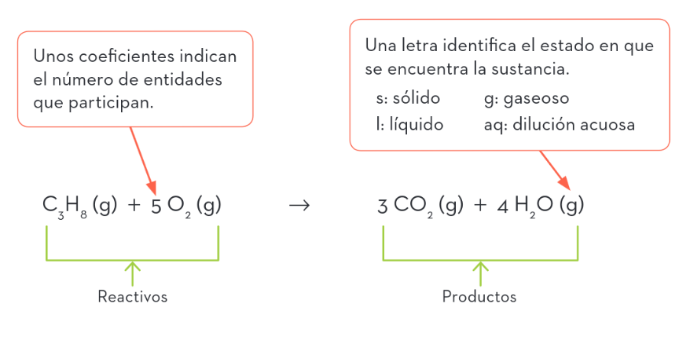{ style="display: block; margin: 0 auto; width: 75%; height: auto;" }

### **Ajuste de reacciones químicas** {: .caja-subtitulo #no-toc}

Observa la siguiente ecuación química:

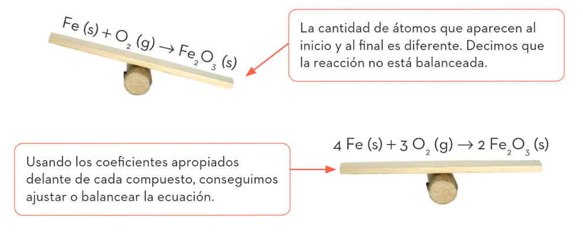{ style="display: block; margin: 0 auto; width: 75%; height: auto;" }

El **coeficiente estequiométrico** indica la proporción de partículas del compuesto que reaccionan o se producen en el proceso. Si no aparece ningún número, se asume que es 1.

Dado que los coeficientes estequiométricos indican proporciones, cualquier múltiplo del ajuste sigue siendo válido.

Esencialmente, se dispone de dos sistemas para ajustar ecuaciones químicas:

*   **Mediante tanteo**, que es el más habitual.
*   **Utilizando un sistema de ecuaciones**, que se usa para casos complejos.

**Ejemplo resuelto:**

a) Ajusta mediante tanteo la reacción de formación del óxido de azufre(VI) a partir de sus elementos.

$$\ce{S (s) + O2 (g) \rightarrow SO3 (g)}$$

b) Ajusta mediante un sistema de ecuaciones la reacción de combustión del butano para dar $\ce{CO2}$ y agua en estado gaseoso.

$$\ce{C4H10 (g) + O2 (g) \rightarrow CO2 (g) + H2O (g)}$$

**Solución:**

a) Generalmente, iniciamos con un coeficiente estequiométrico 1 sobre el compuesto con más elementos ($\mathrm{SO}_{3}$). Sin embargo, veremos que no conseguimos ningún número entero para ajustar el oxígeno. En esta situación suponemos que el coeficiente de dicho compuesto es 2. Ahora ya es fácil encontrar los coeficientes del azufre y el oxígeno.

$$\ce{ 2 S (s) + 3 O2 (g) \rightarrow 2 SO3 (g)}$$

b) En primer lugar, se asigna un coeficiente provisional a cada compuesto:

$$\ce{\textbf{a} C4H10 (g) + \textbf{b} O2 (g) \rightarrow \textbf{c} CO2 (g) + \textbf{d} H2O (g)}$$

Luego, se plantea una ecuación para cada elemento, de manera que el número de átomos del mismo sea igual en ambos miembros de la ecuación:

*   **Carbono:** $\ce{\quad 4a = c}$
*   **Hidrógeno:** $\ce{\quad 10a = 2d}$
*   **Oxígeno:** $\ce{\quad 2b = 2c + d}$

Observarás que hay más incógnitas que ecuaciones, por lo que se asigna un valor cualquiera a una de estas incógnitas (por ejemplo $\ce{a = 2}$), y resolvemos el sistema.

Por último, se escribe la reacción ajustada:

$$\ce{2 C4H10 (g) + 13 O2 (g) \rightarrow 8 CO2 (g) + 10 H2O (g)}$$

### **Actividades** {: .caja-subtitulo #no-toc}

Ajusta las siguientes reacciones:

<table>
  <tr>
    <td>$\ce{a)\quad Mn + O2 \longrightarrow Mn2O3}$</td>
    <td>$\ce{b)\quad KClO3 \longrightarrow KCl + O2}$</td>
    <td>$\ce{c)\quad SO2 \longrightarrow O2 + SO3}$</td>
  </tr>
  <tr>
    <td>$\ce{d)\quad CH3-CH3 + O2 \longrightarrow CO2 + H2O}$</td>
    <td>$\ce{e)\quad CO2 + H2O \longrightarrow CH3OH + O2}$</td>
    <td>$\ce{f)\quad H3PO4 + Ca(OH)2 \longrightarrow Ca3(PO4)2 + H2O}$</td>
  </tr>
    <tr>
    <td>$\ce{g)\quad Fe + S \longrightarrow Fe2S3}$</td>
    <td>$\ce{h)\quad N2 + H2 \longrightarrow NH3}$</td>
    <td>$\ce{i)\quad H2O2 \longrightarrow H2O + O2}$</td>
  </tr>
</table>

## **2. Leyes ponderales**

A lo largo del siglo XVIII la determinación precisa de masas y volúmenes permitió obtener las denominadas **leyes ponderales** (del latín *ponderatio*: «pesar»), que permitieron a la química el inicio de su desarrollo como ciencia.

### **A. Ley de conservación de la masa** {: .caja-subtitulo #no-toc}

La ley de conservación de la masa fue enunciada por Antoine Lavoisier en 1785. Esta ley se puede justificar en la reorganización atómica que tiene lugar en una reacción química.

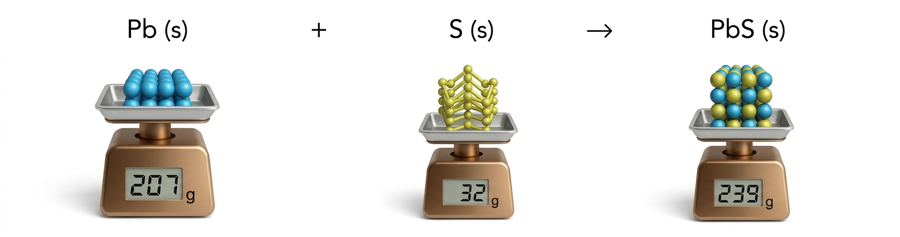{ style="display: block; margin: 0 auto; width: 75%; height: auto;" }

  La <strong>ley de conservación de la masa</strong> afirma que en toda reacción química la masa se conserva, es decir, la masa de los reactivos es igual a la masa de los productos.

### **B. Ley de las proporciones definidas** {: .caja-subtitulo #no-toc}

La tabla muestra diferentes experimentos realizados para la formación del amoniaco. ¿Qué sucede con la proporción entre sus masas?

| $\ce{\textbf{Exper.}}$ | $\ce{\textbf{mN (g)}}$ | $\ce{\textbf{mH (g)}}$ |  $\ce{\dfrac {\textbf{mN (g)}}{\textbf{mH (g)}}}$ | 
| :: | :: | :: | :: |
| A | 16,8 |3,6 | 4,66 | 
| B | 23,8 | 5,1 | 4,66 |
| C | 29,4 | 6,3 | 4,66 |

Sobre experimentos similares, en 1799 Louis Proust pudo justificar lo siguiente:

  La <strong>ley de las proporciones definidas</strong> establece que, cuando dos o más elementos se combinan para formar un mismo compuesto, la relación (cociente) entre sus masas es siempre constante.

Esto explica, por ejemplo, que el agua pura proveniente de Siberia tenga la misma composición que la proveniente del Mediterráneo o del espacio exterior.

### **C. Ley de las proporciones múltiples** {: .caja-subtitulo #no-toc}

Esta tabla muestra la proporción entre el oxígeno y el cloro en la formación de diferentes compuestos. 

| $\ce{\textbf{Exper.}}$ | $\ce{\textbf{mCl (g)}}$ | $\ce{\textbf{mO (g)}}$ |  $\ce{\dfrac {\textbf{mCl (g)}}{\textbf{mO (g)}}}$ | 
| :: | :: | :: | :: |
| A | 70,9 | 16 | 4,43 |
| B | 70,9 | 48 = A · 3 | 1,47 |
| C | 70,9 | 80 = A · 5 | 0,88 |
| D | 70,9 | 112 = A · 7 | 0,63 |
| E | 212,7 | 144 | 1,47 |
| F | 141,8 | 224 | 0,63 |

A raíz de ella, Dalton enunció la siguiente ley en 1808:

  La <strong>ley de las proporciones múltiples</strong> afirma que, cuando dos elementos se combinan para formar varios compuestos, lo hacen de manera que las masas de uno de ellos, que se combinan con una cantidad fija del otro, mantienen una relación de números sencillos.

Comprueba calculando las relaciones entre las diferentes masas de oxígeno en los casos A, B, C y D. ¿Existen nuevos compuestos según los dos últimos experimentos?

### **D. Ley de los volúmenes de combinación** {: .caja-subtitulo #no-toc}

Gay-Lussac observó en 1808 que la relación entre los volúmenes de los gases implicados en una reacción química sigue un **patrón**.

  <strong>Ley de los volúmenes de combinación:</strong> Los volúmenes de los gases implicados en una reacción mantienen una relación de números enteros sencillos.

En la síntesis del amoniaco se observa la siguiente relación: 

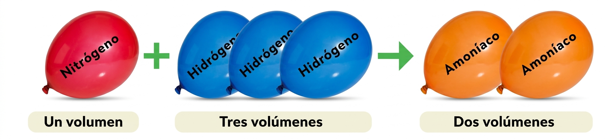{ style="display: block; margin: 0 auto; width: 75%; height: auto;" }

### **E. Hipótesis de Avogadro** {: .caja-subtitulo #no-toc}

Para explicar las relaciones volumétricas obtenidas por Gay-Lussac, se planteó sin éxito el modelo de Dalton, que asumía que todos los elementos gaseosos están formados por partículas monoatómicas.

En 1811, el italiano Amadeo Avogadro propuso un modelo alternativo que ampliaba el concepto de partícula al incorporar la noción de **molécula**.

 <strong>Hipótesis de Avogadro:</strong> Los elementos gaseosos están constituidos por partículas que corresponden a átomos individuales o agrupaciones de átomos denominadas <strong>moléculas</strong>. Todos los gases, en las mismas condiciones de presión, volumen y temperatura, contienen el <strong>mismo número de partículas</strong> (átomos individuales o moléculas).

Bajo esta nueva perspectiva, la ley de los volúmenes de combinación puede ser fácilmente interpretada. Ya no faltan átomos.

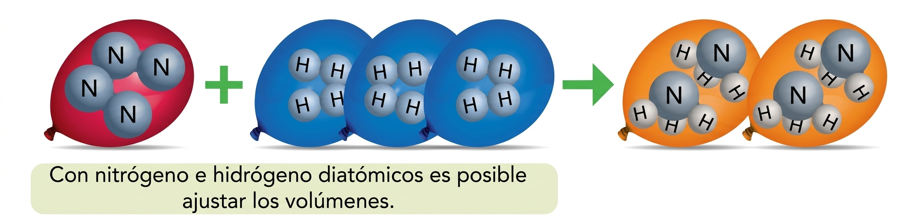{ style="display: block; margin: 0 auto; width: 75%; height: auto;" }

## **3. El mol**

Hasta el momento hemos hablado de partículas y hemos comprendido que la estequiometría de una reacción química muestra la reestructuración entre átomos y moléculas. Sin embargo, cuando llevamos a cabo un proceso químico, la cantidad de partículas implicada es tremendamente elevada.

Al igual que agrupamos los números en docenas, centenas o millares, podemos agrupar los átomos y las moléculas en grandes cantidades. Hay una cantidad especialmente interesante, el mol, pero ¿a cuánto equivale?

  El <strong>mol (n)</strong> es una agrupación de $6,02214076 \cdot 10^{23}$ unidades elementales, cantidad que se conoce como <strong>número de Avogadro</strong> ($N_{\mathrm{A}}$) cuando es expresada en unidades de mol$^{-1}$.

La razón de ese número es histórica. Antes de la revisión de mayo de 2019, el número de partículas de un mol, denominado **constante de Avogadro** ($N_{\mathrm{A}}$), se escogía de manera que, si fueran átomos de carbono-12, la masa de todas ellas expresada en gramos coincidiera con la masa atómica del carbono expresada en umas.

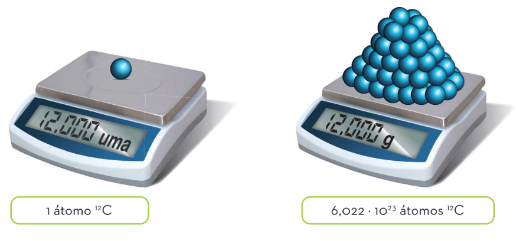{ style="display: block; margin: 0 auto; width: 75%; height: auto;" }

De esta forma, la masa de un mol de cualquier tipo de átomos o moléculas es su masa atómica o molecular expresada en gramos.

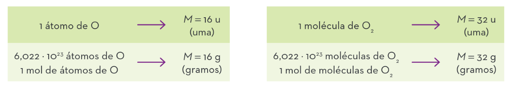{ style="display: block; margin: 0 auto; width: 75%; height: auto;" }

Como el mol corresponde a una agrupación, debe ir siempre seguido de las entidades a las que se refiere: mol de moléculas o mol de átomos. Estas entidades se pueden omitir siempre que se indique la sustancia a la que se refiere y no exista duda.

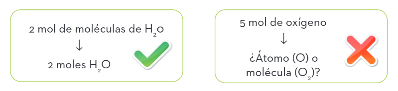{ style="display: block; margin: 0 auto; width: 75%; height: auto;" }

A partir del número de moles ($n$), es posible conocer la cantidad de partículas ($N$) que contiene mediante un factor de conversión o con la expresión:

$$N(\text{partículas}) = n(\text{mol}) \cdot N_{\mathrm{A}}(\text{partículas}\cdot\text{mol}^{-1}) = n(\text{mol}) \cdot \frac{6,022\cdot 10^{23}\ \text{partículas}}{1\ \text{mol}}$$

### **Ejemplo resuelto** {: .caja-subtitulo #no-toc}

¿Cuántos moles y moléculas hay en 235,3 g de ácido sulfúrico?

**Solución:**

En primer lugar, se calcula la masa molar del ácido sulfúrico ($\mathrm{H}_2\mathrm{SO}_4$):

| Masa atómica relativa | $A_r(\mathrm{H}) = 1$ $\quad$ $A_r(\mathrm{O}) = 16$ $\quad$ $A_r(\mathrm{S}) = 32$ |
| :: | :: | 
| Masa molecular relativa | $M_r(\mathrm{H}_2\mathrm{SO}_4) = 2 \cdot A_r(\mathrm{H}) + A_r(\mathrm{S}) + 4 \cdot A_r(\mathrm{O}) = 2 \cdot 1 + 32 + 4 \cdot 16 = 98$ |
| Masa molar | $M(\mathrm{H}_2\mathrm{SO}_4) = 98\ \mathrm{g/mol}$ $\quad \textrm{o} \quad $ $M(\mathrm{H}_2\mathrm{SO}_4) = 98\ \mathrm{g}\cdot\mathrm{mol}^{-1}$  | |

En segundo lugar, se determina la cantidad de moles mediante la expresión:

$$n = \frac{m(\mathrm{g})}{M(\mathrm{sustancia})} = \frac{235,3\ \mathrm{g}}{98\ \mathrm{g}\cdot\mathrm{mol}^{-1}} = 235,3\ \mathrm{g} \cdot \frac{1\ \mathrm{mol}}{98\ \mathrm{g}} = 2,4\ \mathrm{mol}\ \mathrm{de}\ \mathrm{H}_{2}\mathrm{SO}_{4}$$

Por último, las moléculas: $N = n \cdot N_{\mathrm{A}} = 1,445 \cdot 10^{24}$ moléculas $\mathrm{H}_{2}\mathrm{SO}_{4}$

### **Ejercicios sobre reacciones químicas** {: .caja-subtitulo #no-toc}

La **estequiometría** de una reacción es la relación entre el número de moles de cada uno de los compuestos que participan en ella. Esta relación viene plasmada en el valor de los coeficientes estequiométricos.

El mol permite agrupar partículas en cantidades muy grandes, y, además, nos brinda una oportunidad para relacionar dicha cantidad con la masa.

| Escala | $\ce{N2 (g) + 3 H2 (g) \rightarrow 2 NH3 (g)}$ |
| :: | :: |
| Microscópica | 1 molécula $\ce{N2}$ + 3 moléculas $\ce{H2}$ → 2 moléculas $\ce{NH3}$ |
| Macroscópica | 1 mol $\ce{N2}$ + 3 mol $\ce{H2}$ → 2 mol $\ce{NH3}$ |

### **A. Ejercicios con masas** {: .caja-subtitulo #no-toc}

Al interpretar la estequiometría como moles, el estudio de las reacciones a partir de múltiples datos es sencillo. Comencemos utilizando datos de masa.

**Ejemplo resuelto:**

Se hacen reaccionar 10 g de hierro con azufre para obtener sulfuro de hierro(III). ¿Qué cantidad de azufre se necesita y qué masa de producto se obtiene?

**Solución:**

A continuación se plantea la siguiente estrategia de resolución. Este procedimiento se puede aplicar en todos los casos de reacción química:

1.  Planteamos y ajustamos la reacción.
2.  Convertimos los datos a moles.
3.  Relacionamos los moles mediante la estequiometría.
4.  Convertimos los moles a los datos que nos pidan.

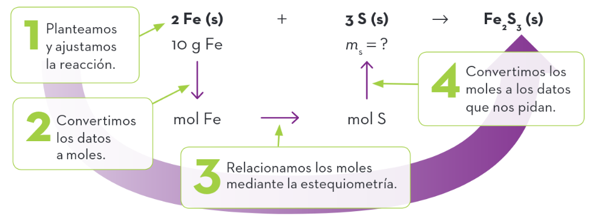{ style="display: block; margin: 0 auto; width: 75%; height: auto;" }

**Importante:** El factor de conversión que se utiliza para relacionar la estequiometría de los compuestos implicados se obtiene de los coeficientes estequiométricos de la reacción.

a) Determinamos las masas molares de las sustancias que nos interesan:

$$\ce{M(Fe) = 55,85 g \cdot mol^{-1} \qquad M(S) = 32,1 g \cdot mol^{-1} \qquad M(Fe2S3) = 208\ g \cdot mol^{-1}}$$

b) Convertimos los datos a moles: $\ce{\qquad n_{Fe} = \dfrac{\ce{m_{Fe} }}{\ce{M(Fe)}} = \dfrac{\ce{10 g}}{\ce{55,85 g \cdot mol^{-1}}} = 0,1791 mol Fe}$

c) Relacionamos la estequiometría de los compuestos de datos conocidos con las sustancias cuyos datos nos preguntan usando factores de conversión:

$$\ce{n_{S} = 0,1791  mol Fe \cdot \left(\dfrac{\ce{3 mol S}}{\ce{2 mol Fe}}\right) = 0,2687 mol S}$$

d) Convertimos los moles a la magnitud solicitada:

$$\ce{n_S = \dfrac{\ce{m_S}}{\ce{M(S)}} \qquad m_S = n_{S} \cdot M(S) = 0,2687 mol S \cdot 32 g \cdot mol^{-1} = 8,5984 g S}$$

e) Para determinar la masa del producto, podemos proceder igual o aplicar la ley de conservación de la masa:

$$\ce{m_{Fe_2S_3} = m_{Fe} + m_{S} = 10 g + 8,5984 g = 18,5984 g}$$

### **B. Ejercicios con disoluciones** {: .caja-subtitulo #no-toc}

Trabajar con masas es cómodo para sustancias sólidas, pero no para disoluciones. En estos casos es mejor trabajar con volúmenes. Para ello, definimos la **concetración molar**.

La <strong>concetración molar</strong> o <strong>molaridad</strong> es la relación entre los moles de soluto y el volumen de la disolución expresado en litros.

$$\ce{[M] = \dfrac {\ce{n (mol)}}{\ce{V (L)}} }$$

Su unidad es el $\ce{mol/L = mol \cdot L^{-1}}$, o tambien llamado <strong>molar</strong> (M).

**Ejemplo resuelto:**

Determina la masa de cloruro de plata (AgCl) que precipita si se añade sal común a 100 mL de una disolución 0,1 M de nitrato de plata (AgNO3) de acuerdo con la reacción ($A_r(\mathrm{Cl}) = 35,45$; $A_r(\mathrm{Ag}) = 107,9$).

**Solución:**

a) Ajustamos la reacción, que en esta ocasión ya está ajustada, y planteamos la estrategia:

$$\ce{AgNO_3(aq) + NaCl(aq)\rightarrow NaNO_3(aq) + AgCl(s)\downarrow}$$

b) Calculamos la masa molar del cloruro de plata: $\ce{M(AgCl) = 143,35 g \cdot mol^{-1}}$

c) Calculamos el número de moles de $\ce{AgNO3}$ que hay en 100 mL = 0,1 L:

$$\ce{[AgNO3] = \dfrac{\ce{n_{AgNO_3}}}{\ce{V}} \quad ; \quad n_{AgNO3} = [AgNO3] \cdot V = 0,1 M \cdot 0,1 L = \dfrac{\ce{0,1 mol}}{\ce{1 L}} \cdot 0,1 L = 0,01 mol AgNO_3}$$

d) Calculamos los moles de AgCl precipitados:

e) Calculamos la masa de AgCl precipitada:

$$\ce{n_{AgCl} = \dfrac{\ce{m_{AgCl}}}{\ce{M(AgCl)}} \quad ; \quad m_{AgCl} = n_{AgCl} \cdot M(AgCl) = 1,434 g AgCl}$$

### **C. Ley de los gases ideales** {: .caja-subtitulo #no-toc}

Cuando se trabaja con gases, es más fácil medirlos en términos de volúmenes. Avogadro relacionó estos volúmenes con la cantidad de partículas que los componen, dependiendo de la presión y la temperatura a la que se encuentran.

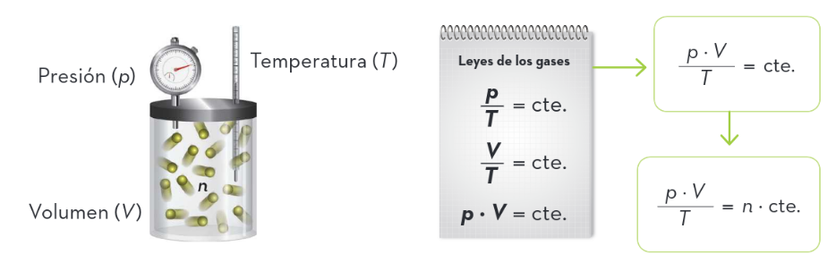{ style="display: block; margin: 0 auto; width: 75%; height: auto;" }

Llamando $R$ a la constante y operando se obtiene una de las relaciones más importantes de la ciencia.

La <strong>ley de los gases ideales</strong> es la expresión que relaciona las magnitudes de un gas con el número de moles de partículas que lo forman:
$$\ce{p\cdot V = n\cdot R\cdot T}$$
Siendo $\ce{R = 0,082 atm \cdot L \cdot mol^{-1} \cdot K^{-1}}$ cuando las unidades son $\ce{p}$ (atm), $\ce{V}$ (L) y $\ce{T}$ (K).

Observarás que las magnitudes de los gases dependen únicamente del número de partículas y no de la composición del gas. Una consecuencia importante es la siguiente:

Un mol de cualquier gas ocupa en condiciones normales (CN) un volumen de 22,4 L. Este valor se conoce como <strong>volumen molar</strong>.

### **Importante** {: .caja-subtitulo #no-toc}

Al igual que en otras áreas de física y química, en el estudio de los gases se escogen unas condiciones privilegiadas para compartir datos experimentales. Existen dos importantes:

*   **Condiciones normales:** $\ce{\quad p = 1 atm}$, $\ce{T = 0 ^{\circ}C}$
*   **Condiciones estándar:** $\ce{\quad p = 1 atm}$, $\ce{T = 25 ^{\circ}C}$

**Ejemplo resuelto:**

Se disponen 5 g de oxígeno ($\ce{O2}$) y 5 g de nitrógeno ($\ce{N2}$) en un recipiente de 5 litros a $\ce{27^{\circ}C}$. Determina la presión que soporta el recipiente.

**Solución:**

Ambas sustancias son gaseosas en las condiciones del problema, produciendo cada una de ellas una presión independientemente de la existencia de la otra. Aplicando a cada gas la ecuación de los gases:

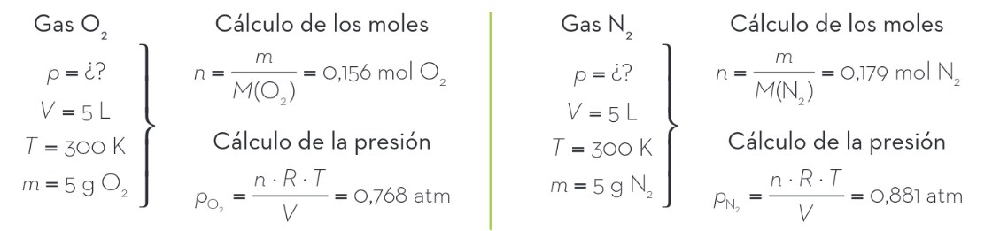{ style="display: block; margin: 0 auto; width: 90%; height: auto;" }

La presión total es la suma de ambas presiones: $\ce{p_{T} = p_{O_2} + p_{N_2} = 1,649}$ atm.

### **D. Ejercicios con gases** {: .caja-subtitulo #no-toc}

Si involucramos la relación entre moles de un gas y el volumen que ocupa, podemos ampliar el estado de las sustancias que se estudian en las reacciones.

**Ejemplo resuelto:**

La combustión del magnesio con oxígeno se utilizaba para producir el flash necesario para hacer fotografías. ¿Qué volumen de oxígeno en CN se consumía si se utilizaban unos 6 gramos para un retrato de grupo? ($A(\mathrm{Mg}) = 24,3$)

**Solución:**

a) Planteamos la reacción ajustada: $\ce{\quad 2 Mg(s) + O2 (g) \rightarrow 2 MgO(s)}$

b) Determinamos los moles de magnesio: $\ce{\quad n_{Mg} = \dfrac{\ce{m_{Mg}}}{\ce{M(Mg)}} = 0,2469 mol Mg}$

c) Necesitamos la mitad de moles de oxígeno: $\ce{\quad n_O = 0,1235 mol O2}$

d) Los convertimos a volumen: $\ce{\quad V = \dfrac{\ce{n \cdot R \cdot T}}{\ce{p}} = \dfrac{\ce{0,1235 \cdot 0,082 \cdot 273}}{\ce{1}} = 2,76 L \ de  \ O_2}$

Aquí se pueden ver, resumidas, todas las relaciones que tienen su origen en el mol:

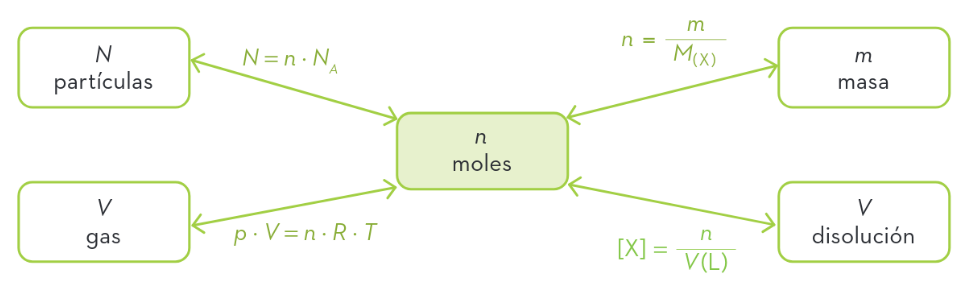{ style="display: block; margin: 0 auto; width: 75%; height: auto;" }

## **4. Termoquímica**

Se puede considerar que las reacciones químicas nos son útiles gracias a dos aspectos. Por un lado, nos permiten obtener sustancias nuevas o eliminar sustancias no deseadas; por otro, podemos aprovechar la energía que pueden absorber o emitir para enfriar o calentar, incluso para mover máquinas.

En la unidad del enlace hemos estudiado que toda unión de dos átomos lleva asociada una energía cuyo valor es negativo. De esta forma, los enlaces serán más fuertes cuanto más negativos sean sus valores. Nuevamente, la naturaleza tiende a situaciones de menos energía.

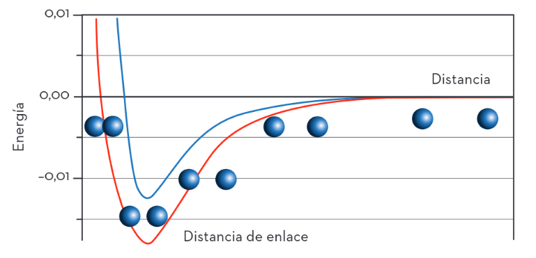{ style="display: block; margin: 0 auto; width: 75%; height: auto;" }

Para romper un enlace será preciso suministrar energía para llevarlo al estado de átomos separados; y, al revés, la formación desprenderá energía.

Como en una reacción química hay una reestructuración de átomos, implica:

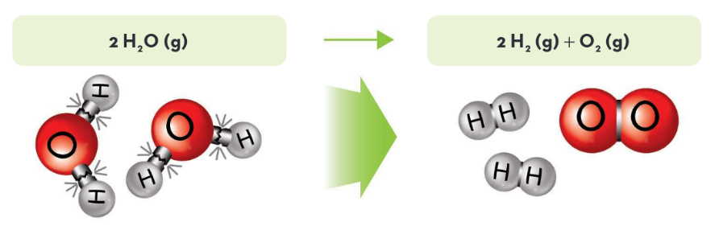{ style="display: block; margin: 0 auto; width: 75%; height: auto;" }

*   Algunos de los átomos que forman los reactivos se han de separar entre sí (**ruptura de enlaces**), lo cual precisa de una cantidad de energía.
*   Posteriormente, cuando vuelven a unirse para formar los productos (**formación de enlaces**), desprenden otra cantidad de energía que es diferente a la anterior.

A un compuesto químico se le puede asignar un nivel energético correspondiente a la suma de sus energías de enlace. Por ejemplo, conociendo que la energía del enlace H–O es de 463 kJ·mol$^{-1}$ en valor absoluto, estimamos el nivel energético de la molécula de agua como:

$$\ce{E_{H_2O} = 2 E_{H-O} = 2 \cdot (-463) = - 926 kJ\cdot mol^{-1}}$$

### **Tipos de reacciones** {: .caja-subtitulo #no-toc}

Comparando los niveles energéticos de los reactivos y los productos en lo que se denomina **balance energético**, podemos determinar si la reacción absorbe o desprende calor.

El balance energético se determina como la diferencia de energía entre los estados inicial y final.

$$\ce{Q = \Delta E = E_{final} - E_{inicial} = E_{productos} - E_{reactivos}}$$

Para facilitar el análisis, se hace uso del **diagrama energético**, un gráfico que permite visualizar el nivel de energía de los reactivos y compararlo con el de los productos. El eje horizontal indica el sentido de avance de la reacción.

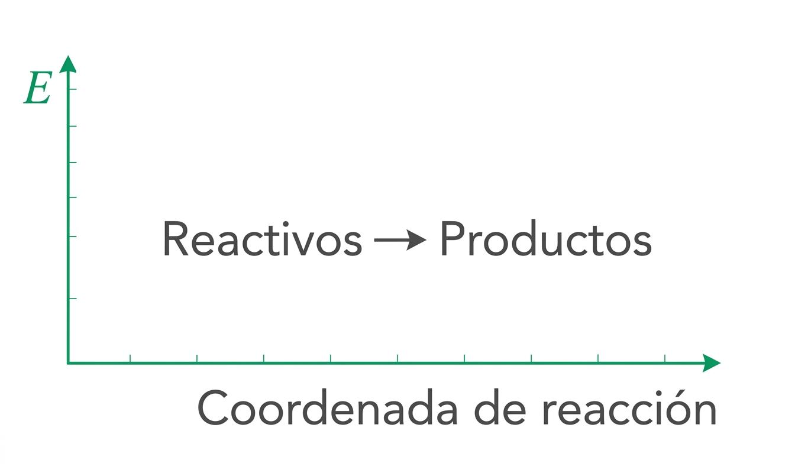{ style="display: block; margin: 0 auto; width: 40%; height: auto;" }

Existen dos situaciones claramente diferenciadas:

| Proceso endotérmico | Proceso exotérmico |
| :--- | :--- |
| El nivel energético de los reactivos es **menor** que el de los productos: $\ce{E_{reactivos} < E_{productos}}$ | El nivel energético de los reactivos es **mayor** que el de los productos: $\ce{E_{reactivos} > E_{productos}}$ |
| El sistema ha de **absorber** energía del entorno. | El sistema ha de **desprender** energía al entorno. |
| Si lo hace en forma de calor, disminuirá la temperatura del entorno. | Si lo hace en forma de calor, aumentará la temperatura del entorno. |
| Formación de ozono: $\ce{3 O2 + Q \rightarrow 2 O3}$ | Combustión de metano: $\ce{CH4 + 2 O2 \rightarrow CO2 + 2 H2O + Q}$ |
| $\ce{Q > 0}$ | $\ce{Q < 0}$ |

### **Ejemplo resuelto** {: .caja-subtitulo #no-toc}

Utilizando las energías de enlace, predice si la reacción de formación del agua en estado gaseoso, según la siguiente reacción, absorbe o desprende calor.

$$\ce{H2 (g) + \dfrac{1}{2} O2 (g) \rightarrow H2O (g)}$$

Realiza su diagrama energético y determina la energía implicada en la formación de 1 kg de agua.

**Datos:** $\ce{\quad E_{H-H} = -436 kJ \cdot mol^{-1}}$, $\ce{E_{O=O} = -499 kJ \cdot mol^{-1}}$, $\ce{E_{H-O} = -463 kJ \cdot mol^{-1}}$

**Solución:**

Necesitaremos determinar las energías de las sustancias que forman los estados inicial y final para estimar la energía de los reactivos y productos.

*   Cálculo de las energías de los compuestos (todos los valores en kJ·mol$^{-1}$):

$$\ce{E_{H_2} = E_{H-H} = -436 kJ \cdot mol^{-1} \qquad \qquad E_{O_2} = E_{O=O} = -499 kJ \cdot mol^{-1}}$$

$$\ce{E_{H_2O} = 2 \cdot E_{H-O} = -926 kJ \cdot mol^{-1}}$$

*   Determinamos la energía de los reactivos y la de los productos:

$$\ce{E_{react.} = E_{H_2} + \dfrac{1}{2} E_{O_2} = -436 kJ \cdot mol^{-1} + \dfrac{1}{2} \cdot (-499 kJ \cdot mol^{-1}) = -685,5 kJ \cdot mol^{-1}}$$

$$\ce{E_{prod.} = E_{H_2O} = -926 kJ \cdot mol^{-1}}$$

*   Obtenemos el calor involucrado restando el estado final y el inicial:

$$\ce{Q = E_{prod.} - E_{react.} = (-926 kJ \cdot mol^{-1}) - (-685,5 kJ \cdot mol^{-1}) = -240,5 kJ \cdot mol^{-1}}$$

*   El diagrama energético donde se recogen todos los resultados es:

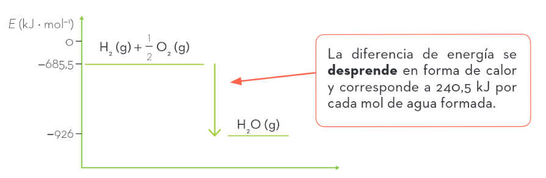{ style="display: block; margin: 0 auto; width: 75%; height: auto;" }

*   Un kilogramo de agua equivale a:

$$\ce{n_{H_2O} = \dfrac {\ce{m_{H_2O}}}{\ce{M(H2O)}} = \dfrac{\ce{1000 g}}{\ce{18 g \cdot mol^{-1}}} = 55,56 mol H2O}$$

*   Con lo que se desprenden $\ce{Q = -240,5 kJ \cdot mol^{-1} \cdot 55,56 mol = -13.362,18 kJ}$

## **5. Cinética química**

Ya hemos visto que una reacción química es una reorganización de átomos y que lleva aparejado un determinado intercambio energético. Pero ¿suceden todas las reacciones a la misma velocidad?

### **Factores cinéticos** {: .caja-subtitulo #no-toc}

Para poder responder a esta pregunta, debemos considerar los siguientes factores:

- **Naturaleza de los reactivos.** Determinadas sustancias reaccionan más rápidamente que otras. Según los elementos, los enlaces serán más o menos fuertes, con lo que la energía será más elevada; y por ello, las sustancias, más o menos reactivas.

- **Superficie de los reactivos sólidos.** Cuanto mayor es la superficie, mayor es la velocidad de la reacción. Al aumentar el grado de división de los reactivos, aumenta la superficie de contacto. Con ello aumenta también el número de choques eficaces y, en consecuencia, observaremos una mayor velocidad.

- **Concentración de los reactivos.** Al aumentar la concentración de los reactivos, mayor es la velocidad de la reacción. Al existir un mayor número de partículas, sucederán más colisiones, lo que incrementará la velocidad.

- **Temperatura del sistema.** Un aumento de la temperatura del sistema repercute en un incremento de la velocidad de reacción. Al elevar la temperatura, las partículas colisionarán con mayor energía, con lo que se incrementará el número de choques eficaces. Una mayor cantidad de partículas conseguirá superar la barrera que representa el estado de transición y alcanzar los productos. Se observa, pues, un incremento de la velocidad de reacción.

- **Existencia de un catalizador.** Son sustancias que incrementan la velocidad de reacción (catalizador positivo). Existen otras sustancias denominadas **inhibidores** que bloquean el mecanismo de reacción más rápido, provocando que la reacción transcurra por otro mecanismo con un perfil de mayor energía de activación, lo que se traduce en una disminución de velocidad. Corresponden a sustancias capaces de aumentar o disminuir la energía del estado de transición sin consumirse en el proceso. En consecuencia, será más o menos fácil superar la barrera modificando la velocidad.

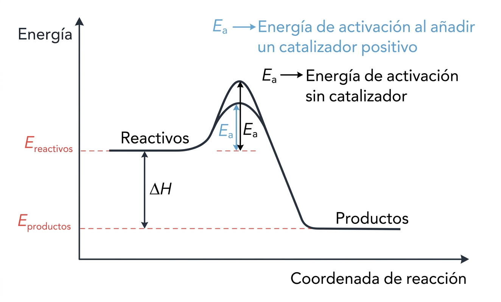{ style="display: block; margin: 0 auto; width: 50%; height: auto;" }

## **6. Reacciones ácido-base**

El zumo de limón o de naranja, los refrescos de cola y los frutos rojos son conocidos por su sabor ácido. Por el contrario, el bicarbonato, las sales de fruta y las verduras poseen un gusto más seco y algo jabonoso, correspondiente a una base. Pero ¿cómo podemos diferenciar este diferente comportamiento a nivel químico?

### **Teoría de Arrhenius** {: .caja-subtitulo #no-toc}

S. A. Arrhenius fue el primero en ofrecer una explicación sencilla y clara acerca del comportamiento ácido-base de los compuestos:

*   **Ácido:** toda sustancia que en disolución acuosa se disocia produciendo iones $\ce{H^+}$, también conocidos como iones hidrógeno (1+).
  
    $$\ce{HAc(aq) \rightarrow H^{+} (aq) + Ac^{-} (aq)}$$

*   **Base:** toda sustancia que en disolución acuosa se disocia produciendo aniones hidróxido $\ce{OH^-}$.

    $$\ce{BOH (aq) \rightarrow B^{+} (aq) + OH^{-} (aq)}$$

Determinadas sustancias pueden presentar un doble comportamiento, mostrando el carácter ácido o básico según el compuesto al que se enfrenten. Estas sustancias se denominan **anfóteros**. El agua es un ejemplo de anfótero.

$$\mathrm{H_2O(aq)} \rightleftharpoons \mathrm{H}^{+}(\mathrm{aq}) + \mathrm{OH}^{-}(\mathrm{aq})$$

Dos críticas se le pueden hacer a esta teoría:

*   Solo se puede aplicar a disoluciones acuosas.
*   No permite explicar el carácter básico de sustancias como el amoniaco $\mathrm{NH_3}$, ya que no tiene hidróxidos ($\mathrm{OH}^{-}$) que pueda perder.

### **Escala de pH** {: .caja-subtitulo #no-toc}

Para determinar el grado de acidez o basicidad, se utiliza la concentración de hidrones [H+] de la disolución, pues un ácido la aumenta y una base la disminuye. Al ser el valor de dicha concentración demasiado pequeño, se utiliza su logaritmo decimal cambiado de signo para obtener números más cómodos.

$$\ce{pH = -\log \ [H^+]}$$

Como el agua pura ya tiene hidrones, el valor de pH neutro no es nulo, sino que está situado en el siete. Una disolución ácida contendrá una concentración mayor de hidrones, pero, a causa del exponente negativo, su pH es menor que siete.

Si trabajamos con bases, calculamos el $\ce{pOH = -\log \ [OH^-]}$ y obtenemos el pH a partir de la expresión: $\ce{pH + pOH = 14}$.

Para determinar el valor de pH se puede utilizar el denominado **papel indicador**, una tira de papel cuyo color cambia de acuerdo con la acidez de la disolución.

### **Ejemplo resuelto** {: .caja-subtitulo #no-toc}

Calcula el pH de una disolución de ácido nítrico ($\ce{HNO3}$) 0,001 M.

**Solución:**

*   Planteamos la reacción: $\ce{HNO3 (aq) \rightarrow H^{+} (aq) + NO3^{-} (aq)}$
*   Determinamos la concentración de ácido: $\ce{[HNO3] = 0,001 M = 10^{-3} M}$
*   Como la estequiometría es 1:1 entre el nítrico y los hidrones: $\ce{[H^+] = 10^{-3} M}$
*   Determinamos el pH: $\ce{pH = -\log \ [H^+] = -\log \ (10^{-3} M) = 3 < 7}$ (ácido)

